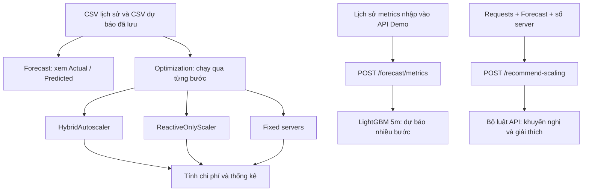

# Demo và cơ chế chính sách Autoscaling

Tài liệu độc lập mô tả hành vi theo mã nguồn hiện tại. File được đặt tại thư mục gốc, bên ngoài các module `demo/`, `forecasting/`, `optimization/`; không thay thế README chính.

## 1. Hệ thống giải quyết việc gì?

Hệ thống sử dụng lượng HTTP request để dự báo tải và quyết định số server cần dùng. Demo cho phép xem kết quả dự báo, chạy mô phỏng scaling trên dữ liệu lịch sử và so sánh chi phí giữa ba chiến lược: Hybrid, Reactive và Fixed.

Đây là mô phỏng và API đưa khuyến nghị. Mã hiện tại chưa tạo/xóa máy ảo, chưa thay đổi Kubernetes replicas và chưa lấy CPU thực tế từ hệ thống giám sát. Các quyết định scaling là luật viết sẵn; mô hình ML dự báo lượng request, không trực tiếp học chính sách điều khiển.

## 2. Phần demo đang dùng gì?

| Thành phần | Công nghệ / dữ liệu | Vai trò thực tế |
|---|---|---|
| Giao diện | Streamlit | Nhận lựa chọn, hiển thị dữ liệu và chạy mô phỏng bằng Python |
| Biểu đồ | Plotly, Altair | Vẽ request, dự báo, số server và chi phí |
| Xử lý dữ liệu | pandas, NumPy | Đọc CSV, căn chỉnh thời gian, tính thống kê |
| API | FastAPI, Pydantic, Uvicorn | Kiểm tra đầu vào và phục vụ HTTP endpoints |
| Gọi API từ UI | `requests` | Tab API Demo gọi server qua HTTP |
| Dữ liệu đầu vào | `data/*_autoscaling.csv` | Lượng request đã tổng hợp theo 1, 5, 15 phút |
| Dự báo có sẵn | `forecasting/artifacts/predictions/` | Kết quả Hybrid, XGBoost, LightGBM đã tính trước |
| Dự báo từ metrics qua API | LightGBM 5 phút | Nạp `forecasting/artifacts/models/lightgbm_5m.txt` và chạy dự đoán |
| Chính sách mô phỏng | `HybridAutoscaler`, `ReactiveOnlyScaler` | Tính số server cho từng bước dữ liệu |
| Chi phí và đánh giá | `CloudCostModel`, `MetricsCollector` | Tính chi phí, CPU ước lượng, vi phạm và số lần scaling |

Dashboard hiện có **4 tab**: Overview, Forecast, Optimization, API Demo. Chi phí nằm trong Optimization, không có tab Cost Analysis riêng.

### 2.1. Overview: xem dữ liệu lịch sử

- Chọn CSV từ `data/`.
- Xem lượng request, tải trung bình, đỉnh tải, cờ burst/event và các biểu đồ phân tích.
- Các cờ trong dữ liệu đã xử lý không đồng nghĩa với kết quả của bộ phát hiện anomaly online trong autoscaler.

### 2.2. Forecast: hiển thị dự báo đã tính trước

Tab đang dùng `demo/app/forecast_tab_simple.py`, không phải file `forecast_tab_plotly.py`.

Luồng thực tế:

1. Chọn model: Hybrid, XGBoost hoặc LightGBM; chọn khung 1m, 5m hoặc 15m.
2. Đọc `{model}_{timeframe}_predictions.csv` trong `forecasting/artifacts/predictions/`.
3. Nếu có cột `split`, chỉ lấy các dòng `test`.
4. Chọn cột dự báo theo thứ tự: `y_pred`, `hybrid_predicted`, `predicted`, `yhat`.
5. Nếu có `timestamp` và `y_true`, lấy luôn dữ liệu thực từ file dự báo. Nếu không, đọc CSV test tương ứng và cố gắng ghép theo timestamp.
6. Vẽ Actual/Predicted, tính lại MAE, RMSE, sMAPE trên các cặp được sử dụng.

**Đổi model trên tab này là đổi file kết quả đang xem. Tab không huấn luyện lại và không chạy inference model tại thời điểm bấm chọn.** Nếu thiếu file dự báo, tab báo cảnh báo và dừng hiển thị.

### 2.3. Optimization: mô phỏng theo từng bước

Người dùng chọn dataset test, timeframe, model dự báo, có dùng forecast hay không, có bật anomaly hay không; đồng thời đặt capacity/server, min/max server và số server Fixed để so sánh.

Khi bấm `Run Optimization`:

1. Nạp dữ liệu test và CSV dự báo nếu bật forecast.
2. Nếu file dự báo có `timestamp` và `y_true`, dùng dữ liệu thực trong file đó thay cho dataset ban đầu; nếu không, cố gắng ghép theo timestamp.
3. Nếu thiếu dự báo, vẫn chạy mô phỏng nhưng bỏ lớp Predictive.
4. Suy ra độ dài mỗi bước từ trung vị khoảng cách timestamp.
5. Tạo mới các bộ điều khiển và chạy hết chuỗi dữ liệu. Mỗi lần bấm chạy lại, trạng thái mô phỏng được khởi tạo lại.
6. Tại bước `i`, truyền `requests[i]` và `predictions[i]` vào Hybrid; chạy thêm Reactive và Fixed để tính chi phí đối chiếu.
7. Hiển thị đồ thị, chi phí tích lũy và thống kê.

Forecast được truyền cùng chỉ số với request. Mô phỏng chưa thể hiện thời điểm phát hành dự báo, độ trễ khởi động máy hay việc chờ máy sẵn sàng; thay đổi số server được coi là có hiệu lực ngay trong bước đang xét.

### 2.4. API Demo: gọi dịch vụ riêng

Tab này dùng HTTP, mặc định tới `http://localhost:8000`, gồm:

- Kiểm tra kết nối bằng `GET /health`.
- Nhập/nạp lịch sử metrics và gọi `POST /forecast/metrics`.
- Thử các tình huống scaling bằng `POST /recommend-scaling`.

Hai thao tác dự báo và khuyến nghị scaling được thực hiện riêng trong UI. Endpoint khuyến nghị nhận trường `forecast` do người gọi cung cấp; bản thân endpoint không tự gọi mô hình ML.

## 3. Luồng hoạt động tổng thể



Hai khái niệm dễ nhầm:

- **Hybrid model** là mô hình dự báo kết hợp Prophet và LSTM.
- **Hybrid autoscaler** là bộ điều khiển phối hợp anomaly, emergency, predictive và reactive. Nó có thể nhận dự báo từ bất kỳ model nào được chọn, kể cả LightGBM hoặc XGBoost.

## 4. Quy ước tải và tham số mặc định

Gọi `R` là request trong một bước, `F` là dự báo request, `N` là số server và `C` là capacity của một server trong cùng khoảng thời gian.

```text
utilization = R / (N × C)
CPU ước lượng (%) = utilization × 100
```

Ví dụ: 800 request, 2 server, mỗi server xử lý 500 request/bước → CPU ước lượng 80%.

Capacity phải cùng đơn vị với dữ liệu: nếu mỗi dòng là 5 phút thì `C = 500` nghĩa là 500 request/server/5 phút. Giữ nguyên capacity khi chuyển sang dữ liệu 15 phút sẽ thay đổi ý nghĩa tải của thí nghiệm.

| Tham số Hybrid mô phỏng | Mặc định |
|---|---:|
| Capacity/server | 500 request/bước |
| Min / max servers | 2 / 20 |
| Số server khởi tạo | Bằng min servers |
| Bật anomaly | Có |
| Cooldown | 5 bước theo kiểm tra khoảng cách bước |
| Ngưỡng ghi nhận SLA / SLO | CPU ≥ 95% / ≥ 85% |
| Forecast safety margin | 0,80 |
| Hệ số bổ sung khi tính target Predictive | 1,20 |
| Hysteresis margin trong Reactive Hybrid | 0,20 |
| Giới hạn mức tăng Anomaly/Emergency | Tối đa 5 server/lần |

CPU là đại lượng suy ra tuyến tính từ request, có thể vượt 100%; không phải số đo CPU phần cứng. SLA/SLO ở đây là ngưỡng mô phỏng trên đại lượng này, chưa phải phép đo uptime hoặc latency.

## 5. Chính sách Hybrid trong tab Optimization

Nguồn: `optimization/hybrid_autoscaler.py`.

### 5.1. Thứ tự quyết định

```text
Tăng bộ đếm bước
  → Tính CPU từ số server hiện có
  → Nếu đang cooldown: giữ nguyên và trả về ngay
  → Layer 0: Anomaly
  → Nếu số server chưa đổi: Layer 1: Emergency
  → Nếu số server chưa đổi và có forecast: Layer 2: Predictive
  → Nếu số server chưa đổi: Layer 3: Reactive
  → Chặn kết quả trong [min_servers, max_servers]
  → Ghi nhận thay đổi và trả kết quả
```

Điều kiện chuyển sang lớp tiếp theo là **số server chưa thay đổi**, không chỉ là lớp trước có phát hiện vấn đề hay không. Mỗi bước trả về một số server cuối cùng và một chuỗi lý do như `LAYER1_EMERGENCY`, `LAYER2_PREDICTIVE`, `COOLDOWN`.

### 5.2. Cooldown: hạn chế thay đổi liên tục

Sau một lần đổi số server, lưu `last_scale_step`. Khi:

```text
current_step - last_scale_step < 5
```

thì trả về `COOLDOWN`. Nếu vừa scale ở bước `t`, các bước `t+1` đến `t+4` bị chặn; bước `t+5` được xét lại.

Với dữ liệu đều 5 phút, khoảng cách tối thiểu giữa hai lần scale là 25 phút; với 1 phút là 5 phút; với 15 phút là 75 phút.

**Cooldown được kiểm tra trước cả Anomaly và Emergency.** Vì vậy quá tải trong cooldown cũng không kích hoạt scaling ngay. Trong các bước này, lịch sử anomaly không được cập nhật và bộ đếm vi phạm nội bộ của Hybrid cũng không tăng; MetricsCollector ngoài dashboard vẫn ghi nhận bước dữ liệu.

### 5.3. Layer 0 — Anomaly Detection

Nguồn: `optimization/anomaly_detection.py`.

Bộ phát hiện giữ tối đa 50 giá trị đã được đưa vào detector. Cần ít nhất 10 giá trị để bắt đầu xét bất thường. Do cooldown bỏ qua detector, đây không nhất thiết là 50 bước dữ liệu liên tiếp.

Mỗi lần cập nhật, bốn phương pháp bỏ phiếu:

| Phương pháp | Điều kiện kích hoạt |
|---|---|
| Rate of change | `abs((R - R_trước) / R_trước) > 0,8`, khi giá trị trước > 0 |
| Z-score | Độ lệch so với trung bình lịch sử trước điểm hiện tại > 3 độ lệch chuẩn |
| IQR | Ngoài `[Q1 - 1,5×IQR, Q3 + 1,5×IQR]` của lịch sử trước điểm hiện tại |
| Moving average deviation | Lệch quá 3 độ lệch chuẩn so với tối đa 10 giá trị trước đó |

Cần ít nhất 2/4 phiếu. Các phép chia theo độ lệch chuẩn chỉ được xét khi độ lệch chuẩn > 0. `confidence = số phiếu / 4` là mức đồng thuận của luật, không phải xác suất đã hiệu chỉnh.

Khi có anomaly:

```text
increment = min(int(N × 0,3), 5)
target = clamp(N + increment, min_servers, max_servers)
```

Hành vi cần biết:

- Cả tăng đột biến và giảm đột biến đều có thể bị đánh dấu; lớp này luôn đề xuất tăng server.
- Với 2 hoặc 3 server, `int(N × 0,3) = 0`, nên lớp này không tăng được server. Các lớp sau tiếp tục được xét.

### 5.4. Layer 1 — Emergency

Khi CPU ước lượng **≥ 95%**, áp dụng cùng công thức tăng 30%, lấy phần nguyên và tối đa 5 server như Anomaly.

Ví dụ: 10 server → tăng 3; 20 server → target bị chặn bởi max servers. Với 2 hoặc 3 server, mức tăng tính ra vẫn bằng 0; đây là hạn chế của triển khai hiện tại.

### 5.5. Layer 2 — Predictive

Chỉ xét khi `F > 0` và:

```text
F > 0,70 × N × C
```

Số server mục tiêu:

```text
required = F / C
required_safe = required / 0,80
target = clamp(int(required_safe × 1,20), min_servers, max_servers)
       = clamp(int(1,5 × F / C), min_servers, max_servers)
```

Ví dụ: `N = 4`, `C = 500`, `F = 1800`. Vì 1800 > 1400, target = `int(5,4) = 5`: tăng từ 4 lên 5.

Chính sách dành dư năng lực so với số server tính từ tải thuần. Công thức dùng `int` lấy phần nguyên, không dùng `ceil`. Lớp này không có giới hạn tăng tối đa 5 server. Trong một số trường hợp làm tròn, target có thể bằng hoặc thấp hơn N; mã không bắt buộc Predictive chỉ được tăng.

### 5.6. Layer 3 — Reactive trong Hybrid

Ngưỡng được tính từ `HYSTERESIS_MARGIN = 0,20`:

```text
scale_out_threshold = 0,70 - 0,20 = 0,50
scale_in_threshold  = 0,30 + 0,20 = 0,50
```

| Điều kiện | Quyết định |
|---|---|
| Utilization > 50% | Tăng 1 server |
| Utilization < 50% và N > min | Giảm 1 server |
| Utilization = 50% | Giữ nguyên |

Kết quả cuối cùng vẫn bị chặn bởi min/max. Dù tên tham số là hysteresis, hai ngưỡng hiện trùng nhau ở 50%, nên không có một dải tải giữ nguyên rộng giữa ngưỡng tăng và giảm. Cooldown hạn chế tần suất thay đổi.

## 6. Hai chiến lược dùng để so sánh

### 6.1. Reactive Only

Nguồn: `optimization/reactive_scaler.py`, được cấu hình trong tab Optimization.

- Khởi tạo bằng min servers, dùng cùng capacity và giới hạn min/max với Hybrid.
- Utilization **> 75% trong 2 lần xét liên tiếp** → tăng 1 server.
- Utilization **< 35%** và trên min → giảm 1 server, không cần chờ 2 bước thấp tải.
- Sau khi scale, bỏ qua 2 bước tiếp theo do cooldown.
- Không dùng dự báo và không dùng anomaly detector.

Đây là bộ luật khác với lớp Reactive 50% nằm bên trong Hybrid. Vì các ngưỡng và cooldown khác nhau, chênh lệch chi phí không chỉ phản ánh tác dụng của ML.

### 6.2. Fixed

Giữ nguyên số server do người dùng nhập cho toàn bộ chuỗi dữ liệu. UI mặc định bằng min servers, không tự chọn số server đủ phục vụ peak load.

Fixed chủ yếu được dùng đối chiếu chi phí và số server. Một cấu hình Fixed rất nhỏ có thể rẻ nhưng thiếu năng lực. Dashboard hiện không tính đầy đủ bộ chỉ số SLA cho cả Reactive và Fixed như với Hybrid, nên cần thận trọng khi kết luận chiến lược nào tốt hơn từ đồ thị chi phí.

## 7. Chính sách tính chi phí

Nguồn mô phỏng: `optimization/cost_model.py`.

| Loại | Giá giả định / server / giờ | Cách phân bổ |
|---|---:|---|
| Reserved | 0,03 USD | Tối đa `min_servers` trong mô phỏng |
| Spot | 0,015 USD | Lấy phần nguyên 70% số server vượt Reserved |
| On-Demand | 0,05 USD | Phần còn lại |

Với `H = số phút mỗi bước / 60`:

```text
reserved = min(N, reserved_capacity)
remaining = max(0, N - reserved)
spot = int(remaining × 0,70)
on_demand = remaining - spot

cost_step = H × (reserved × 0,03 + spot × 0,015 + on_demand × 0,05)
cost_total = tổng cost_step
```

Ví dụ: 5 server, Reserved capacity = 2, mỗi bước 5 phút:

- Reserved = 2; Spot = `int(3 × 0,7) = 2`; On-Demand = 1.
- Chi phí = `(2×0,03 + 2×0,015 + 1×0,05) × 5/60` ≈ **0,01167 USD/bước**.

Ba chiến lược đều dùng cùng CloudCostModel. Mô hình có khai báo startup cost nhưng chưa cộng phí khởi động vào kết quả. Chưa mô phỏng gián đoạn Spot, giá biến động, network/storage hoặc nghĩa vụ trả phí Reserved khi không sử dụng. Giá trên là hằng số giả định trong mã, không phải bảng giá cloud đang được cập nhật.

Chi phí do dashboard tính bên ngoài Hybrid. `HybridAutoscaler.cost_accumulator` chưa được cập nhật trong `step()`, nên trường total_cost của `get_summary()` không phải tổng chi phí dashboard.

## 8. API dự báo đang hoạt động như thế nào?

### 8.1. `POST /forecast/metrics`

Endpoint này chỉ hỗ trợ **LightGBM, timeframe `5m`**:

1. Nhận `history` gồm ít nhất 6 điểm `{timestamp, requests}` và `horizon_steps` từ 1 đến 100.
2. Sắp xếp lịch sử theo thời gian, tạo 13 đặc trưng: giờ/ngày, sin/cos giờ, lag 5m/15m/6h/1d, rolling mean/max 1h, burst và event.
3. Nạp model `lightgbm_5m.txt` từ artifacts/models; mã còn có một số tên file dự phòng.
4. Dùng đặc trưng dòng cuối để dự báo, chặn dự báo âm về 0.
5. Thêm giá trị dự báo vào lịch sử, tăng timestamp 5 phút, cập nhật đặc trưng và lặp cho các bước sau.
6. Trả danh sách `{step, predicted_requests}`; UI dựng mốc thời gian tương lai để vẽ.

Ví dụ request, dùng timestamp đầy đủ để rõ ngày và giờ:

```json
{
  "timeframe": "5m",
  "history": [
    {"timestamp": "1995-08-23T12:00:00", "requests": 410},
    {"timestamp": "1995-08-23T12:05:00", "requests": 435},
    {"timestamp": "1995-08-23T12:10:00", "requests": 460},
    {"timestamp": "1995-08-23T12:15:00", "requests": 490},
    {"timestamp": "1995-08-23T12:20:00", "requests": 520},
    {"timestamp": "1995-08-23T12:25:00", "requests": 550}
  ],
  "horizon_steps": 3
}
```

Các giới hạn hiện tại:

- Sáu điểm đủ qua kiểm tra số lượng nhưng không đủ lịch sử 6 giờ/1 ngày. Đặc trưng thiếu được điền, nhiều lag dài có thể bằng 0; ở bước dự báo sau, lag thiếu có thể dùng giá trị dự báo thay thế.
- Mã giả định khoảng cách 5 phút khi tính lag, chưa kiểm tra chặt lịch sử có đều 5 phút hay không.
- Feature engineering trong API khác training: rolling có chứa điểm hiện tại, công thức burst khác, `is_event` luôn bằng 0. Đây là nguồn sai lệch cần đồng bộ trước khi tin vào chất lượng inference.
- Lượt dự báo đầu dùng đặc trưng dòng lịch sử cuối, chưa tạo riêng dòng đặc trưng cho timestamp tương lai trước lần gọi model đầu tiên.
- Nếu không nạp/chạy được model, endpoint trả lỗi; không dùng heuristic dự phòng ở endpoint này.

### 8.2. Các hàm dự báo cũ

`demo/utils/forecast.py` còn có `forecast_next` và `forecast_on_data`, được một số endpoint khác sử dụng. Chúng thử CSV/model ở các nhánh tương ứng và có thể chuyển sang heuristic khi không có dự báo. `forecast_next` hiện không có nhánh suy luận LightGBM riêng; không nên hiểu mọi lựa chọn model trong các API cũ đều đang chạy đúng model đó.

Tab Forecast chính hiện đọc CSV trực tiếp, không đi qua các hàm suy luận cũ này. Thông tin `/forecast/predict` xuất hiện trong mô tả API nhưng hàm `predict` hiện không được gắn decorator route tương ứng; không nên xem danh sách trong response `/` là bằng chứng endpoint đã được đăng ký.

## 9. Chính sách riêng của `POST /recommend-scaling`

Nguồn: `HybridAutoscalerAnalyzer` trong `demo/api.py`. **Endpoint này không gọi `optimization.HybridAutoscaler`.** Nó tính khuyến nghị độc lập cho dữ liệu mỗi request, không duy trì lịch sử tải, không có cooldown và không tự thực thi scaling.

Đầu vào:

```json
{
  "current_servers": 3,
  "requests": 1400,
  "forecast": 1600,
  "capacity_per_server": 500
}
```

### 9.1. Thứ tự và ngưỡng

| Bước | Điều kiện | Xử lý |
|---|---|---|
| Anomaly alert | `forecast > 0` và `abs(requests - forecast) / forecast > 0,50` | Thêm cảnh báo; tự nó không đổi số server |
| Emergency | Utilization **> 95%** | Tăng `max(1, N // 2)`, chặn trên ở 20 |
| Predictive | Số server theo forecast **> N + 1** | Chuyển lên số server theo forecast |
| Reactive tăng | Utilization **> 80%** | Tăng 1, tối đa 20 |
| Reactive giảm | Utilization **< 30%** và N > 2 | Giảm 1, tối thiểu 2 |
| Còn lại | Không trúng các điều kiện trên | Giữ nguyên |

Số server theo forecast được tính:

```text
forecast_servers_needed = clamp(int(F / C) + 1, 2, 20)
```

Đây là lấy phần nguyên rồi cộng 1; khi F chia hết cho C vẫn cộng thêm 1. Nếu số server cần chỉ hơn hiện tại đúng 1, nhánh Predictive chưa được kích hoạt; quyết định tiếp tục phụ thuộc Reactive theo tải hiện tại.

Ví dụ `N=3, R=1400, F=1600, C=500`: utilization ≈ 93,33%, số server theo forecast = 4. Không trúng Emergency, không trúng Predictive vì 4 không > 4, nhưng trúng Reactive >80% nên đề xuất 4 server.

`confidence` là hằng số gán theo nhánh: Emergency 0,95; Predictive 0,80; Reactive tăng 0,70; giảm 0,75; ổn định 0,85. Nó không phải xác suất từ mô hình ML. Cảnh báo anomaly có thao tác tăng confidence ban đầu nhưng giá trị sau đó bị nhánh quyết định ghi đè.

Chuỗi giải thích anomaly hiện ghi ±20% quanh forecast, trong khi điều kiện thật là lệch >50%. Khi đọc kết quả nên căn cứ điều kiện trong mã.

### 9.2. Chi phí trong API khuyến nghị

API mặc định 2 Reserved server, phần vượt được tính bằng tỷ trọng **70% Spot + 30% On-Demand dưới dạng số thực**, không làm tròn thành số máy như CloudCostModel của mô phỏng:

```text
cost_hour = min(N, 2) × 0,03
          + max(0, N-2) × (0,70 × 0,015 + 0,30 × 0,05)
```

Response trả chi phí hiện tại, chi phí đề xuất, chênh lệch và phần trăm thay đổi. Vì cách chia Spot khác, kết quả chi phí API và mô phỏng có thể khác nhau dù số server giống nhau.

### 9.3. Đối chiếu hai bộ chính sách

| Đặc điểm | Optimization / HybridAutoscaler | API / HybridAutoscalerAnalyzer |
|---|---|---|
| Trạng thái | Lịch sử anomaly, bước, lần scale trước | Tính theo đầu vào từng request |
| Cooldown | Có, kiểm tra trước mọi lớp | Không |
| Anomaly | Bỏ phiếu 4 phương pháp, có thể tăng server | Lệch forecast >50%, chỉ cảnh báo |
| Emergency | CPU ≥95%; tăng phần nguyên 30%, tối đa 5 | CPU >95%; tăng ít nhất 1, khoảng 50% |
| Predictive | Kích hoạt trên 70% capacity; target `int(1,5F/C)` | Target `int(F/C)+1`; chỉ kích hoạt nếu > N+1 |
| Reactive | Tăng trên 50%, giảm dưới 50% | Tăng trên 80%, giảm dưới 30% |
| Min/max | UI cấu hình | Hằng số 2/20 trong analyzer, chưa chặn toàn cục mọi đầu vào |
| Cost | Chia số máy Spot bằng phần nguyên | Chia tỷ trọng chi phí bằng số thực |

## 10. Chỉ số hiển thị nên hiểu thế nào?

- **MAE/RMSE/sMAPE**: sai số giữa dự báo lưu trong CSV và giá trị thực được ghép với nó.
- **Total Cost**: tổng chi phí theo từng bước mô phỏng.
- **Scaling Events**: số bước có thay đổi số server; tăng 5 server trong một bước vẫn tính là 1 sự kiện.
- **Avg Servers**: trung bình số server sau quyết định của từng bước.
- **SLA Violations**: số bước CPU ước lượng ≥95%, không phải số request lỗi hay số sự cố độc lập.
- **SLO Violations**: số bước CPU ước lượng ≥85%.
- **Violation rate**: số bước vi phạm / tổng số bước; với bước thời gian đều có thể diễn giải là tỷ lệ thời gian mô phỏng.

MetricsCollector của dashboard tính CPU và vi phạm theo **số server sau scaling**. Trong khi đó `metrics['cpu']` của Hybrid và bộ đếm vi phạm nội bộ tính trên **số server trước scaling**. Vì vậy hai nguồn thống kê có thể khác nhau; dashboard lấy SLA Violations tổng hợp từ MetricsCollector.

Trường `efficiency` trong MetricsCollector đang dùng ngưỡng 0,95 với CPU ở thang phần trăm, nên chưa thể diễn giải như thước đo hiệu suất chuẩn. UI hiện không dùng trường này làm chỉ số chính.

## 11. Cách chạy demo

Từ thư mục gốc dự án, sau khi cài dependencies:

```bash
pip install -r demo/requirements.txt
```

Chạy dashboard:

```bash
streamlit run demo/app/dashboard.py
```

Chạy API ở terminal riêng nếu cần tab API Demo:

```bash
python demo/api.py
```

- Dashboard thường ở `http://localhost:8501`.
- API mặc định ở `http://localhost:8000`; Swagger ở `/docs`.
- Forecast và Optimization xử lý dữ liệu/file trực tiếp trong tiến trình Streamlit, không yêu cầu gọi API để chạy các luồng đó.
- Model nhị phân đang có cho LightGBM và XGBoost trong `forecasting/artifacts/models/`; chưa có đầy đủ artifact Prophet/LSTM để tái hiện suy luận Hybrid. CSV dự báo Hybrid vẫn có thể dùng để xem và mô phỏng.
- Một số đường dẫn mặc định trong demo vẫn trỏ tới `forecasting/models/` là nơi chứa mã định nghĩa model. Điều này ảnh hưởng các nhánh nạp model cũ; endpoint `/forecast/metrics` và các tab đọc CSV chính có đường dẫn artifacts riêng.

Tài liệu này được đối chiếu tĩnh với mã nguồn; không khẳng định đã chạy thành công toàn bộ UI/API trong môi trường hiện tại.

## 12. Các file nguồn để tra cứu

- [Điểm vào dashboard](demo/app/dashboard.py)
- [Tab Forecast đang dùng](demo/app/forecast_tab_simple.py)
- [Mô phỏng Optimization và cấu hình baseline](demo/app/optimization_tab.py)
- [Tab gọi API](demo/app/api_demo_tab.py)
- [API và bộ luật khuyến nghị riêng](demo/api.py)
- [Inference LightGBM từ metrics](demo/utils/metrics_forecast.py)
- [Các hàm forecast cũ và fallback](demo/utils/forecast.py)
- [Hybrid autoscaler](optimization/hybrid_autoscaler.py)
- [Anomaly detector](optimization/anomaly_detection.py)
- [Reactive baseline](optimization/reactive_scaler.py)
- [Mô hình chi phí](optimization/cost_model.py)
- [Thu thập chỉ số](optimization/metrics.py)
